# 1 · Creativity as a construct {.background-slide}

## Why creativity, and what it is

- Creative thinking is listed among the core competences for work and education [@wef2025; @oecd2024].
- In sport, creative actions decide tight games, and creativity is a declared training goal [@safardilha2019; @santos2016].

::: {.fragment}
::: {.text-box style="margin-top:0.3em"}
**The standard definition** [@stein1953; @runco2012]

"Creativity requires both **originality** and **effectiveness**." Original things must also work: useful, fitting, appropriate in context.
:::
:::

::: {.fragment}
- But "creative" is used loosely: for people, processes, environments and products alike. **Which of these do we measure, and how?**
:::

::: notes
Bipartite definition: originality alone is not creativity, nor is effectiveness alone. Stein (1953) is the origin; Runco and Jaeger (2012) traced and formalised it as the standard definition. For a football action: unusual and functional in the game context. The last bullet is the problem that leads to the next slides.
:::

## A credibility problem, and a reset in 2019

::::: columns
::: {.column width="50%"}
::: {style="font-size:0.9em"}
**For decades, creativity assessment suffered from**

- inconsistent terminology ("creativity" meaning different things in different studies),
- no shared taxonomy of what is being measured,
- weak psychometric reporting of the instruments.

Result: the construct lost credibility outside the field.
:::
:::

::: {.column width="50%"}
::: {.fragment}
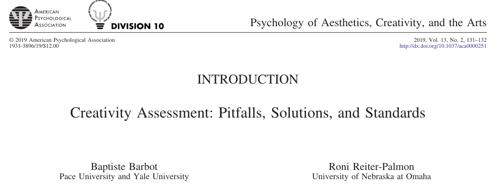{.paper-header width="86%"}

::: {.white-box style="font-size:0.66em; margin-top:0.4em; padding:0.5em 0.8em"}
"That notwithstanding, enduring **conceptual and methodological issues** and the **lack of established assessment standards** still challenge the validity of creativity studies, limit meta-analytical work, and make the creativity literature at times elusive to the novice eye." [@barbot2019, p. 131]
:::
:::
:::
:::::

::: notes
The special issue of Psychology of Aesthetics, Creativity, and the Arts (2019, 13(2)) is the current reference point for standards. The quote is from the editors' introduction. The synthesis by Barbot, Hass and Reiter-Palmon (2019) concludes with two standards: transparency (define, operationalise and report which facet a score covers, and claim nothing beyond it; there is no all-purpose creativity test) and homogenisation (for the same facet, standardise tasks and their administration, because even small variations shift the meaning of scores). They also note that the three most used methods, divergent thinking, CAT and self-report, each cover only part of the phenomenon.
:::

## Which facet? Taxonomies of creativity {.smaller}

::::: columns
::: {.column width="40%"}
**Rhodes's four Ps** [@rhodes1961]

- **Person**: traits, abilities, personality
- **Process**: thinking, motivation, learning
- **Press**: the environment that presses on person and process
- **Product**: the idea or artefact that is judged

The classic frame for sorting creativity measures.
:::

::: {.column width="60%"}
::: {.fragment fragment-index="1"}
**Batey's heuristic framework** [@batey2012]: the four Ps as one axis, joined with level and measurement approach

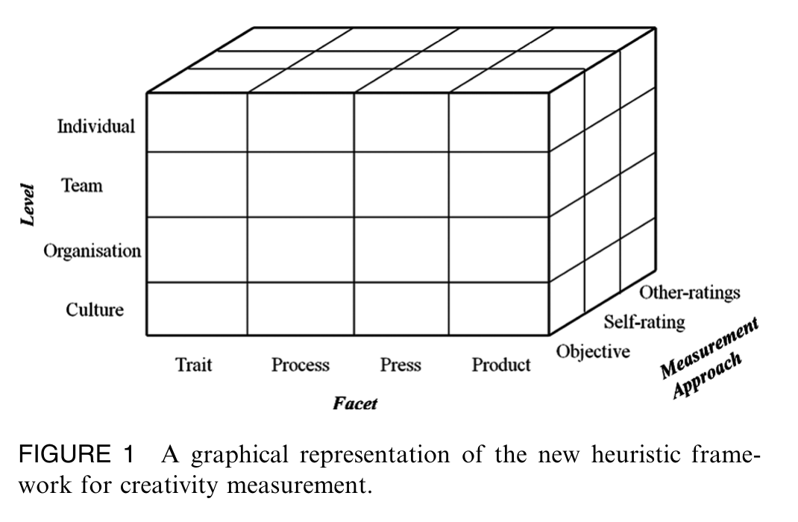{.nostretch width="66%"}
:::
:::
:::::

::: {.fragment fragment-index="2"}
::: {.white-box style="margin-top:0.4em"}
**This study sits in one cell:** individual · **product** · **other-ratings**. Single actions of a player, rated by independent observers.
:::
:::

::: notes
Rhodes (1961) proposed the four Ps. Batey (2012) uses them as the facet axis of his cube and adds level and measurement approach; he calls it a heuristic. Barbot (2019) separates potential, performance and achievement, a distinction that goes back to Guilford (1966). The point: there is more than one taxonomy, but they correspond, and in each our object is the judged product.
:::

## How creativity is assessed {.smaller auto-animate=true auto-animate-duration="0.8"}

::: {.diagram-container data-id="methods"}
::: {.diagram-box data-id="box-dt"}
**Divergent thinking tasks**<br>
<span style="font-size:0.8em">"Name unusual uses of a brick." Fluency, flexibility, originality. Also convergent-thinking and insight tasks</span><br>
<span style="font-size:0.75em"> Facet: ***Process***</span>
:::
::: {.diagram-box data-id="box-sr"}
**Self- and other-reports**<br>
<span style="font-size:0.8em">Questionnaires, achievement and activity inventories, personality</span><br>
<span style="font-size:0.75em"> Facet: ***Person***</span>
:::
::: {.diagram-box data-id="box-cat"}
**Consensual Assessment Technique (CAT)**<br>
<span style="font-size:0.8em">Experts rate products independently. Also non-CAT ratings by teachers or coaches</span><br>
<span style="font-size:0.75em"> Facet: ***Product***</span>
:::
:::

::: notes
Three families of methods for three facets. The next click morphs the boxes down to their names and brings in the usage shares.
:::

## How creativity is assessed {.smaller auto-animate=true auto-animate-duration="0.8"}

```{=html}
<div class="fragment custom cat-highlight" data-fragment-index="2"></div>
```

::: {.diagram-container data-id="methods"}
::: {.diagram-box data-id="box-dt"}
**Divergent thinking tasks**
:::
::: {.diagram-box data-id="box-sr"}
**Self- and other-reports**
:::
::: {.diagram-box .cat-box data-id="box-cat"}
**Consensual Assessment Technique (CAT)**
:::
:::

::: {.white-box style="font-size:0.9em; padding:0.45em 1em; margin:0.2em 0 0.4em 0"}
@paca2019 coded every creativity measure in 446 studies (1984–2013):
:::

::: {.fragment fragment-index="1"}
::: {.diagram-container .props style="margin:0 0 0.3em 0"}
::: {.diagram-box}
**43%**<br><span style="font-size:0.75em">divergent / convergent thinking</span>
:::
::: {.diagram-box}
**45%**<br><span style="font-size:0.75em">self-report</span>
:::
::: {.diagram-box .cat-box}
**34%**<br><span style="font-size:0.75em">product ratings, CAT and non-CAT</span>
:::
:::

::: {.citation}
Shares of studies; they exceed 100% because many studies use several measures; other measures 16%.
:::
:::

::: {.fragment .fade-up fragment-index="2"}
- **CAT** [@amabile1982; @hennessey2011; @kaufman2024]: a product is creative to the extent that **appropriate observers independently agree** that it is creative.
- Judges familiar with the domain, judging **independently**, with **no criteria imposed**, relative to the other products, in random order. 
:::

::: notes
Click 1: the shares of 446 studies (DT/convergent thinking 43%, self-report 45%, product ratings 34%, other 16%; shares exceed 100% because studies use several measures). Barbot, Hass and Reiter-Palmon (2019) name the same three as the most popular methods. Click 2: the CAT, the method for products, designed for collages, poems, stories: static material. Note the "no criteria" rule; we will come back to it. In sport, research has concentrated on the process; products in competition were rated only by small panels of trained coaches (backlog slide).
:::

# 2 · Automated assessment and the rating study {.background-slide}

## Our idea: automated scores, validated against human ratings {.smaller}

- For verbal creativity, fine-tuned language models reach *r* = .76 to .81 with human ratings of the Alternate Uses Task, semantic-distance models only .12 to .26 [@organisciak2023]. Every one of them is trained on and validated against **human ratings**.

::: {.fragment fragment-index="1"}
::: {.diagram-container style="margin:0.5em 0 0.5em 0; font-size:0.9em"}
::: {.diagram-box}
**Event data**<br><span style="font-size:0.8em">StatsBomb: type, location, pressure, outcome, context</span>
:::
::: {.diagram-arrow}
&nbsp;
:::
::: {.diagram-box}
**Candidate models**<br><span style="font-size:0.75em">
* semantic distance (LSA)
* outlier detection (Isolation Forest, One-Class SVM)
* transformer architectures</span>
:::
::: {.diagram-arrow}
&nbsp;
:::
::: {.diagram-box}
**Creativity score**<br><span style="font-size:0.8em">of the action</span>
:::
:::
:::

::: {.fragment fragment-index="2"}
- **The validation standard**: human ratings obtained with the CAT
- Previous football studies relied on **three or four raters per action, averaged**
- we started collecting, aiming at **two to three raters for as many actions as possible**.
:::

::: notes
The original DFG-style project idea: train a model on event (and maybe tracking) data to score creativity, compare model families, validate against CAT ratings. This talk is not about the automated models; they are paper 2. Step one is labels, so we set up a CAT-style rating study.
:::

## The rating study and the app {.smaller}

::::: columns
::: {.column width="44%"}
**Material**

Single actions from matches in men's and women's Euros and World Cups, AFCON, Copa América, cut as short video clips, linked to event data.

**Instruction**

Creativity = originality × functionality in the game context, after @runco2012.

**Scale**

- Unipolar 7-point creativity scale (1 "not creative" to 7 "very creative") the length the rating-scale literature deems appropriate [@preston2000; @lozano2008]
:::

::: {.column width="56%"}
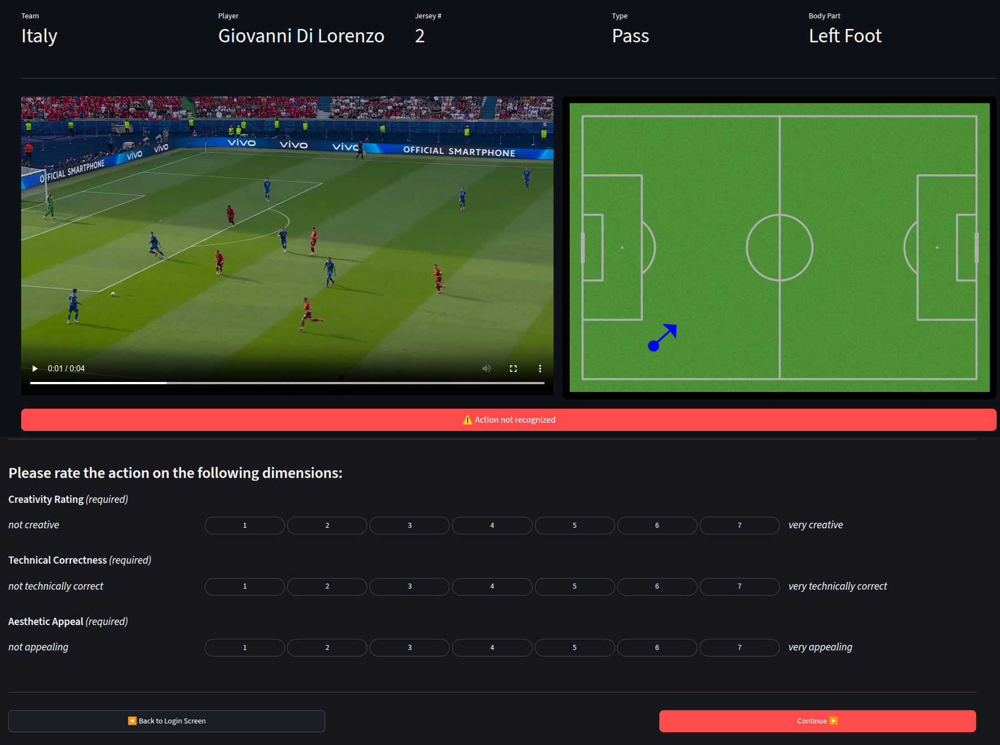{.nostretch width="78%" style="border:1px solid #c3c9d1; border-radius:6px; display:block; margin:0 auto"}

::: {style="text-align:center; font-size:0.85em; margin-top:0.3em"}
**Open source, reusable for any video rating study:**

github.com/maxk92/streamlit-creativity-rating-app
:::
:::
:::::

::: notes
Scale labels in the app: 1 "not creative", 7 "very creative", endpoints only; the full justification of the 7-point unipolar scale and the definition text the raters read are backlog slides. App: metadata and a pitch sketch identify the action; the clip loops; three 7-point scales plus "action not recognised"; randomised order, familiarisation clips, the definition always one click away, progress saved per participant. Configurable by YAML for other scales, clips or studies. Anyone in the institute who needs ratings of video clips can use it.
:::

## We thought this was a labelling task.

::: {.fragment fragment-index="1"}
- **Plan**: collect ratings from two to three raters for as many actions as possible, average them, train the model.
:::
::: {.fragment fragment-index="2"}
- **How many raters does a CAT need?** The literature does not fix it: @kaufman2008 suggest 5 to 10 judges; the football studies used three or four trained coaches [@kempe2018; @roca2018; @joode2023], and none asked how many raters such ratings need or how raters differ. We started collecting, aiming at two to three raters per action.
:::
::: {.fragment fragment-index="3"}
- **Reality**: raters disagreed a lot, used the scale very differently, and most actions had only one or two ratings, from different raters. **Which number is the "creativity of the action"?**

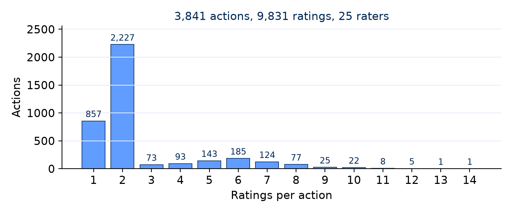{.nostretch width="60%"}
:::

::: notes
9,831 ratings of 3,841 actions by 25 raters; 1 to 14 ratings per action, median 2; the design is incomplete but connected (details on the backlog data slide). The paper now targets Creativity Research Journal as a rating-design paper for nonverbal, time-pressured products. The automated-assessment model is paper 2.
:::

# 3 · The trouble with human raters {.background-slide}

## Two actions, same creativity? {.smaller}

::::: columns
::: {.column width="50%"}
```{=html}
<div class="fragment custom shrink" data-fragment-index="1"></div>
<video class="clip" data-autoplay loop muted playsinline controls>
<source src="media/130df886-9dd1-454f-935a-f593d9726789.mp4" type="video/mp4">
</video>
```

**Dribble A**, Gareth Bale · Wales–Denmark, 8'

::: {.fragment fragment-index="1"}
Ratings: **6** (R19) and **5** (R02) → raw mean **5.5**
:::

::: {.fragment fragment-index="2"}
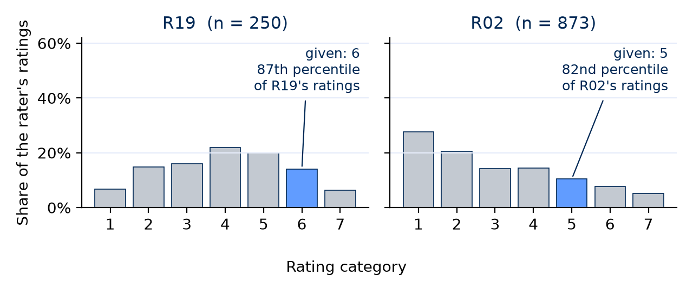{width="80%"}
:::
:::

::: {.column width="50%"}
```{=html}
<div class="fragment custom shrink" data-fragment-index="1"></div>
<video class="clip" data-autoplay loop muted playsinline controls>
<source src="media/085bd6cb-2573-46a6-b145-65f870ce7e9f.mp4" type="video/mp4">
</video>
```

**Dribble B**, Danilo · Brazil–Serbia, 59'

::: {.fragment fragment-index="1"}
Ratings: **3** (R01) and **4** (R06) → raw mean **3.5**
:::

::: {.fragment fragment-index="2"}
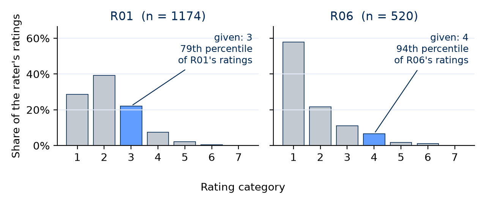{width="80%"}
:::
:::
:::::

::: notes
Two dribbles from the data set, chosen because the model later scores them about equally, within one standard error. Step 1: the ratings, a 2-point gap on a 7-point scale, and both panels agree internally. Step 2: the share of each rater's ratings per category with the given rating highlighted. On each rater's own scale the action sits between the 79th and the 94th percentile: the four raters agree in relative terms. Is dribble A more creative, or did it meet friendlier raters? Keep the audience guessing; the resolution comes in section 4.
:::

## Who rated them? {.smaller}

::::: columns
::: {.column width="58%"}
::: {.r-stack}
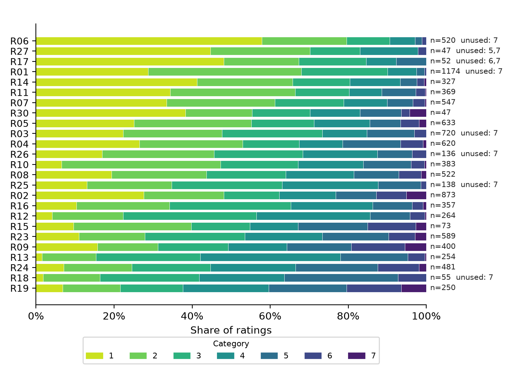{.fragment .fade-out fragment-index="1" width="100%"}

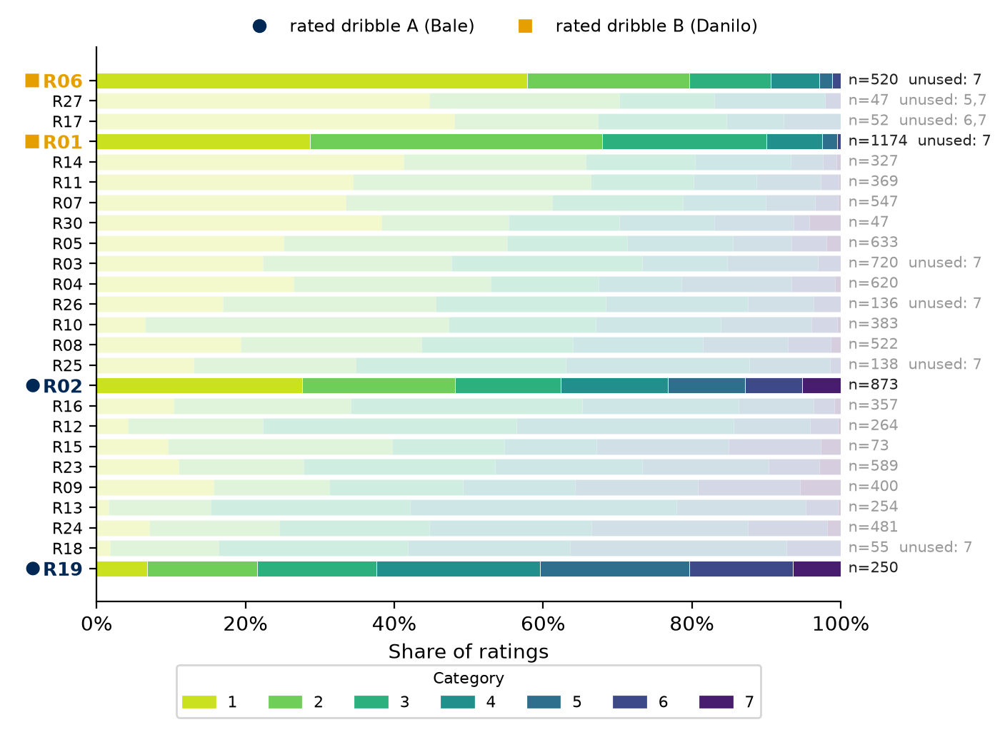{.fragment .fade-in fragment-index="1" width="100%"}
:::
:::

::: {.column width="42%"}
- Raw mean rating per rater: **1.76 (R06) to 4.01 (R19)**.
- Share of the lowest category: **.579 (R06) to .016 (R13)**.
- Eight raters never used at least one category, and none of these eight ever gave a 7.

::: {.fragment fragment-index="1"}
| Rater | Mean | Given | Percentile |
|---|---:|---:|---:|
| ● R19 | 4.01 | 6 | 87th |
| ● R02 | 3.03 | 5 | 82nd |
| ■ R01 | 2.16 | 3 | 79th |
| ■ R06 | 1.76 | 4 | 94th |

::: {.citation}
Percentile: where the given rating sits among the rater's own ratings. ● dribble A, ■ dribble B.
:::
:::
:::
:::::

::: notes
This is just scale use, before any model. Same actions pool, randomly allocated, yet the raters' distributions differ enormously. Dribble A met R19, the most lenient rater, and R02, an average one; dribble B met R01 and R06, two of the strictest. A "4" from R06 lies above 94% of R06's ratings; a "6" from R19 above 87% of R19's. Same relative verdict, 2 points apart in the raw mean.
:::

## The problems, named {.smaller}

::::: columns
::: {.column width="33%" .problem-col}
::: {.fragment fragment-index="1"}
**Severity / leniency**<br>
the same action gets different numbers from different raters.

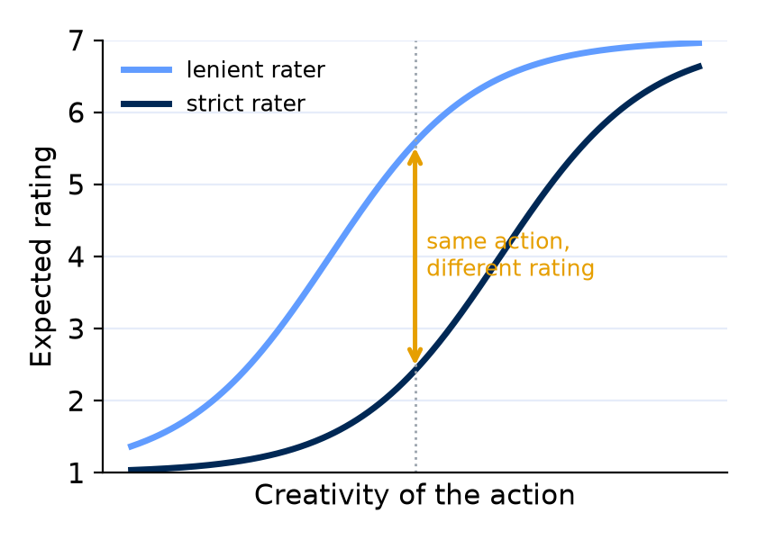
:::
:::
::: {.column width="33%" .problem-col}
::: {.fragment fragment-index="2"}
**Category use**<br>
some raters compress the scale, some never use the top.

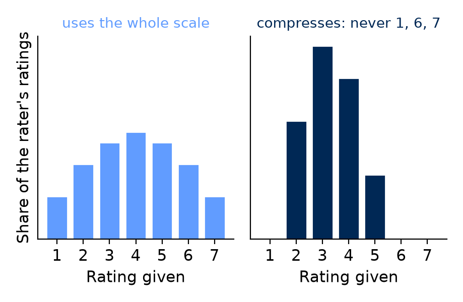
:::
:::
::: {.column width="33%" .problem-col}
::: {.fragment fragment-index="3"}
**Discrimination**<br>
some raters separate actions sharply, others barely.

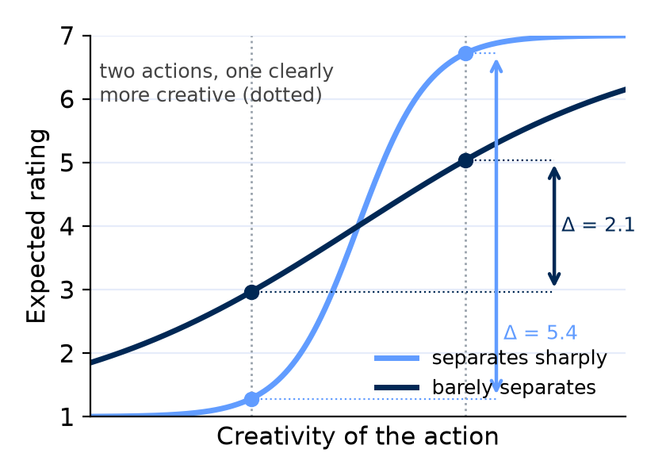
:::
:::
:::::

::: {.fragment fragment-index="4"}
::: {.white-box style="margin-top:0.4em; padding:0.5em 1em"}
**Agreement of single ratings across all 25 raters: Krippendorff's α = .402** [@hayes2007]. With one or two ratings per action, the raw mean mostly reflects who rated.
:::
:::

::: notes
Schematic illustrations, not data. Severity shifts the whole curve; category use is about which numbers a rater is willing to give at all; discrimination is the slope: how much the rating changes when the action changes. Krippendorff's alpha is built for incomplete designs with missing cells, so it fits our data; it describes single ratings. Cronbach's alpha of .959 would look reassuring but describes a hypothetical mean over the whole panel, which no action ever had (backlog slide).
:::

## So study 1 became a methods study

**Three research questions**

::: {.rq-list}
::: {.fragment}
- **RQ1** How reliable are the scores and how does reliability depend on the **number of ratings per action**?
:::
::: {.fragment}
- **RQ2** How do **raters differ** in severity, scale use and discrimination, and how precisely can we tell?
:::
::: {.fragment}
- **RQ3** Which **model** should be used to estimate rater effects and align the ratings, that is, which assumptions need to be **considered or relaxed**, and how much do scores and rankings depend on that choice?
:::
:::

::: notes
The aim slide. The labelling exercise became a rating-design study: reliability and the number of ratings, rater differences, and the choice of the scoring model. Averaging treats raters as interchangeable; they are not. We need a model in which the rater is part of the measurement.
:::

# 4 · From raw means to judge response theory {.background-slide}

## Item response theory {.smaller}

::::: columns
::: {.column width="52%"}
- **A latent variable problem.** θ, the creativity of an action, is unobserved, and it sits on the *predictor* side of the ratings. Ordinary regression needs its predictors observed.
- **The way out**: write down how θ and the rater **generate** a rating, then **invert** the model to recover θ. Item response theory (IRT) is the standard such model for discrete responses.

::: {.fragment fragment-index="1"}
The probability of a correct response depends on the **person** and on the **item**:

$$P(X_{ij} = 1 \mid \theta_i) = \text{logistic}\big(a_j\,(\theta_i - b_j)\big)$$

::: {.param-list}
- <span class="param-sym">θ~i~</span> **latent trait** of person *i*, say ability.
:::
:::

::: {.param-list}
::: {.fragment fragment-index="2"}
- <span class="param-sym">b~j~</span> **difficulty** of item *j*: the θ at which the item is solved with probability .5.
:::

::: {.fragment fragment-index="3"}
- <span class="param-sym">a~j~</span> **discrimination** of item *j*: the slope at b~j~.
:::
:::
:::

::: {.column width="48%"}
::: {.white-box style="text-align:center; font-size:0.85em; padding:0.4em 0.6em"}
::: {.lv-row}
::: {}
**latent creativity** θ<br>unobserved
:::
::: {.lv-plus}
\+
:::
::: {}
**rater tendencies**<br>severity, discrimination
:::
:::
↓ probability of each rating 1 to 7 ↓<br>
**observed rating** X
:::

::: {.fragment fragment-index="1"}
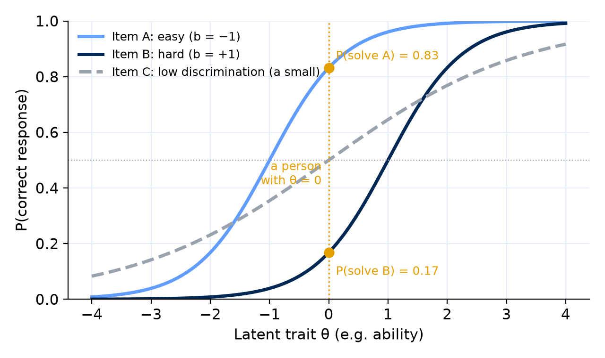{.nostretch width="78%"}

::: {.citation}
Item characteristic curves of three hypothetical items [@lord1980; @embretson2013].
:::
:::
:::
:::::

::: notes
Framing for the non-psychologists: a latent variable problem, like measuring ability. Generating model: latent quantity plus instrument characteristics give the probability of each response, which gives the observed response; estimation inverts it. The person with θ = 0 solves the easy item with probability .83 and the hard one with .17. Item C is flat: it barely tells people apart. Difficulty says where on θ an item is informative, discrimination how much it weighs; with item-specific discrimination the same number of solved items can mean different θ, so IRT estimates θ from the whole response pattern, with a standard error. Estimation details (marginal maximum likelihood, EM) are a backlog slide.
:::

## Judge response theory: the graded response model {.smaller}

::::: columns
::: {.column width="46%"}
- **Items become judges** [@myszkowski2019; @myszkowski2021]: raters take the role of items, actions the role of persons, and each rater's behaviour gets its own parameters.
- **Ratings are ordered categories**, so a rater has one slope and **six thresholds** instead of one difficulty.
- **The sparse but connected design** links every rater to the others through shared actions.
:::

::: {.column width="54%"}
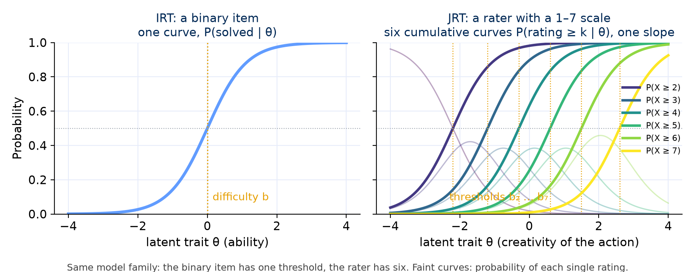{.nostretch width="86%"}
:::
:::::

::: {style="text-align:center; font-size:1.05em; margin:0 0 0.1em 0"}
$$P(X_{ij} \ge k \mid \theta_i) = \text{logistic}\big(a_j\,(\theta_i - b_{jk})\big), \qquad k = 2, \dots, 7$$
:::

::::: columns
::: {.column width="33%"}
::: {.fragment fragment-index="1"}
::: {.white-box style="padding:0.3em 0.7em; font-size:0.92em"}
<span class="param-head">θ~i~</span>
<span class="param-name">creativity of action i</span>
Posterior mean with its own standard error.
:::
:::
:::
::: {.column width="34%"}
::: {.fragment fragment-index="2"}
::: {.white-box style="padding:0.3em 0.7em; font-size:0.92em"}
<span class="param-head">b~jk~</span>
<span class="param-name">thresholds of rater j</span>
Where a rating ≥ k becomes likely; their location is the **severity**.
:::
:::
:::
::: {.column width="33%"}
::: {.fragment fragment-index="3"}
::: {.white-box style="padding:0.3em 0.7em; font-size:0.92em"}
<span class="param-head">a~j~</span>
<span class="param-name">discrimination of rater j</span>
The common slope: how sharply the rating responds to θ.
:::
:::
:::
:::::

::: {.fragment fragment-index="4"}
::: {.citation}
Cumulative form [@samejima1969]. θ is integrated out; rater parameters by marginal maximum likelihood (EM), actions scored as posterior means, in mirt [@chalmers2012].
:::
:::

::: notes
MFRM = many-facet Rasch model, the sport-science audience may know it from judging sports. JRT generalises it: rater-specific thresholds and discriminations, estimated like item parameters. The figure: a binary item has one threshold, the rater has six, same logistic family. On severity: in the rating-scale model the thresholds are one severity plus shared steps, so their mean is the severity parameter; in the GRM the mean of the estimated thresholds tracks M1 severity closely (r = .97) for the raters who used all seven categories.
:::

## The two actions again {.smaller}

::::: columns
::: {.column width="44%"}
| | ● Dribble A (Bale) | ■ Dribble B (Danilo) |
|---|---:|---:|
| Raters | R19, R02 | R01, R06 |
| Severity (M1, logits) | **−1.00**, −0.07 | **+0.76, +1.38** |
| Discrimination a | 1.97, 2.60 | 1.79, 3.15 |
| Ratings given | 6, 5 | 3, 4 |
| **Raw mean** | **5.5** | **3.5** |

::: {.fragment fragment-index="2"}
| | ● Dribble A | ■ Dribble B |
|---|---:|---:|
| **GRM score** $\hat\theta$ (SE) | **1.04** (0.46) | **1.34** (0.47) |
| Rating the full panel would give on average | 4.08 | 4.43 |

::: {.citation}
Last row: model-expected rating at $\hat\theta$, averaged over all 25 raters.
:::
:::
:::

::: {.column width="56%"}
::: {.r-stack}
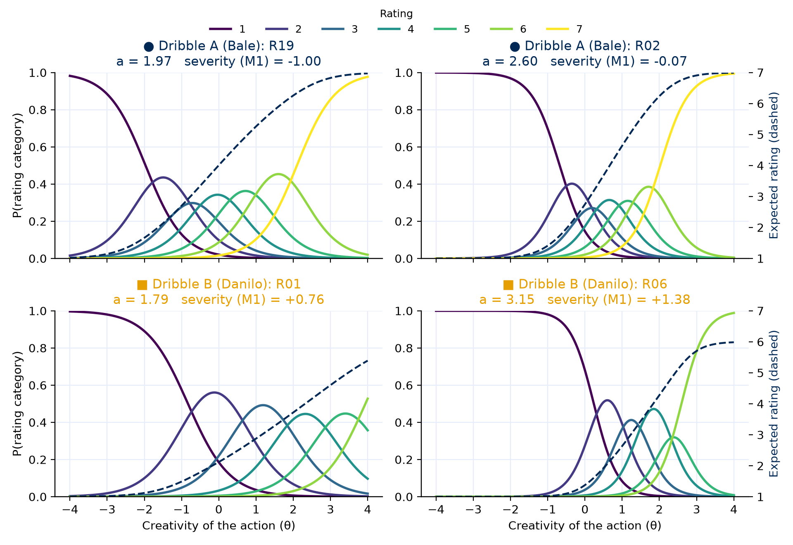{.fragment .fade-out fragment-index="2" width="100%"}

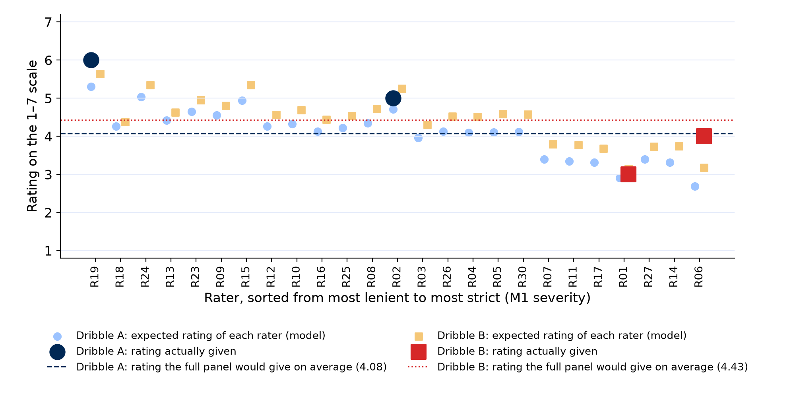{.fragment .fade-in fragment-index="2" width="100%"}
:::
:::
:::::

::: notes
Step 1: the fitted behaviour of the four raters (top row rated dribble A, bottom row dribble B), with discrimination and severity. Step 2: for each rater, the rating they would be expected to give to each of the two actions, sorted from lenient to strict; light markers are model-expected, the dark blue and red markers are the ratings actually given. Once the raters are modelled, the two dribbles are indistinguishable: 1.04 and 1.34 with standard errors of about 0.47, and if anything the raw-mean order is reversed. The 2-point gap in the raw mean is the rater gap. At θ ≈ 1.3, R06 is expected to give about a 3 and R19 about a 5.6: a "4" from R06 corresponds to a "5" or "6" from R19.
:::

# 5 · Preliminary results {.background-slide}

## RQ1 · How many ratings per action? {.smaller}

::::: columns
::: {.column width="60%"}
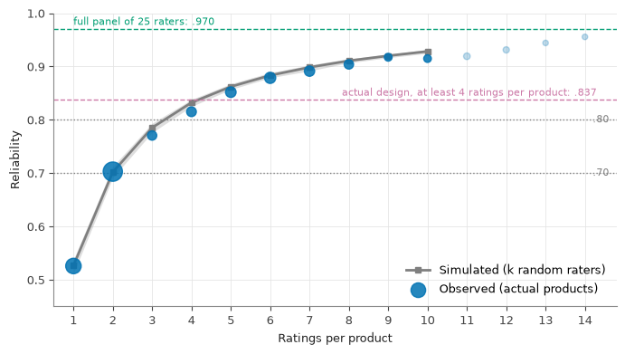{width="100%"}
:::

::: {.column width="40%"}
| Ratings | Observed | Simulated |
|---:|---:|---:|
| 1 | .53 | .53 |
| 2 | .70 | .70 |
| 3 | .77 | .79 |
| **4** | **.82** | **.83** |
| 5 | .85 | .86 |
| 10 | .91 | .93 |

::: {.fragment}
- **The scores we actually have**: empirical marginal reliability **.695** [.673, .711], because most actions were rated once or twice.
- In this rater pool, **four ratings** per action are the smallest number that reaches .80.
- Topping the actual design up to four ratings everywhere (+7,098 ratings) lifts .69 to **.84**.
:::
:::
:::::

::: notes
Empirical marginal reliability = Var(θ̂) / (Var(θ̂) + mean PSD²); the interval comes from 200 draws of the parameter estimates. If every rater had rated every action, the model-based reliability would be .97: the gap is the design, not the raters. Cronbach's alpha (.959, pairwise covariances) would describe a hypothetical panel mean; Krippendorff's alpha (.402) the agreement of single ratings (backlog slide). Dots: observed mean reliability of actual actions with k ratings. Line: simulation with k raters drawn at random from the panel, ratings generated from the fitted model, 50 replications of 2,000 actions. The number is specific to this pool, this scale and this product class.
:::

## RQ2 · Raters differ, and some are hard to pin down {.smaller}

::::: columns
::: {.column width="50%"}
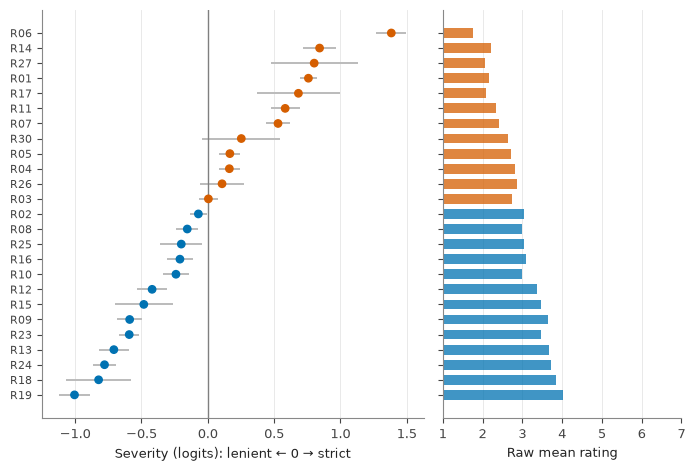{height="330"}

::: {.citation}
Severity (M1) with 95% intervals; right: raw mean rating.
:::
:::

::: {.column width="50%"}
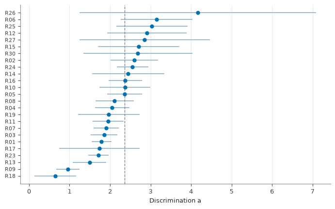{height="330"}

::: {.citation}
Discrimination $a$ (GRM) with 95% intervals; dashed: median.
:::
:::
:::::

::: {style="margin-top:0.5em"}
- Severity spans **2.39 logits** (−1.00 R19 to +1.38 R06); raw mean and severity do not agree one-to-one (R18).
- Discrimination from **0.65 (R18) to 4.17 (R26)**.
- Information per rating **0.13 (R18) to 3.96 (R26)**: one rating from a sharp rater is worth many from a flat one.
- Raters with about **50 ratings** (R17, R18, R27, R30): intervals too wide to say much.
:::

::: notes
A span of 2.4 logits is larger than in comparable MFRM studies of creativity ratings (Primi et al. 2019). Information is the inverse of the squared standard error; the per-rater information functions are a backlog slide. The last point matters for design: 50 ratings per rater is not enough. R26 has 136 ratings by now and still the widest interval (a = 4.17, SE 1.49), because the top category is never used.
:::

## RQ2 · All 25 raters {.smaller}

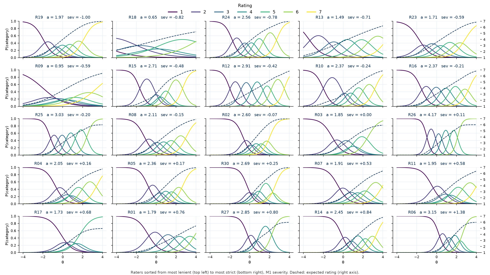{width="94%"}

::: notes
Overview of the fitted category curves of every rater, sorted from lenient to strict. Note the flat ones (R18, R09), the ones with a missing top category, and R27, who never used 5 or 7. Go over it quickly.
:::

## RQ3 · Does the model matter? {.smaller}

::: {.fragment fragment-index="1"}
**Model comparison**: each step relaxes a constraint of the model above (lower AIC, BIC, SABIC is better)

| Model | Constraint relaxed, compared with the model above | AIC | BIC | SABIC |
|---|---|---:|---:|---:|
| M1 rating-scale MFRM [@linacre1989; @eckes2015] | the strictest: one severity per rater, **one shared category structure**, equal discrimination | 30,423 | **30,617** | 30,519 |
| M2 partial-credit MFRM | **rater-specific thresholds** | 29,765 | 30,646 | 30,198 |
| M3 generalized partial credit | **rater-specific discrimination** | 29,635 | 30,667 | 30,143 |
| **GRM** graded response model [@samejima1969] | same parameters as M3, but **cumulative** P(X ≥ k) instead of adjacent-category odds; not nested | **29,586** | **30,617** | **30,093** |

: {tbl-colwidths="[26,44,10,10,10]"}
:::

::::: columns
::: {.column width="50%"}
::: {.fragment fragment-index="2"}
**Likelihood-ratio tests** (nested pairs)

| Comparison | χ² | df | *p* |
|---|---:|---:|---:|
| M1 vs M2: rater-specific thresholds | 878.6 | 110 | < .001 |
| M2 vs M3: rater-specific discriminations | 177.4 | 24 | < .001 |

::: {.citation}
The GRM is not nested and is compared by information criteria only. df of M1 vs M2 would be 120 if every rater had used all 7 categories.
:::
:::
:::

::: {.column width="50%"}
::: {.fragment fragment-index="3"}
**Final model (GRM) vs raw mean**: how far scores and rankings differ

| Ratings per action | Kendall τ~b~ | reversed pairs | $\hat\theta$ range at the same raw mean (mean / max) |
|---|---:|---:|---:|
| 1 | .77 | 7.6% | 1.24 / 1.42 |
| 2 | .82 | 6.6% | 1.56 / 2.13 |
| 3+ | .86 | 6.5% | 0.51 / 1.31 |
:::
:::
:::::

::: notes
Both constraints are rejected. The GRM wins on AIC and SABIC; on BIC it ties with M1 (30,617.0 vs 30,617.4), which is why both are bold. Between the models, Spearman correlations of the scores are .980 to .997; the real gap is between any model and the raw mean: about 7% of all action pairs change order, and actions with the same raw mean spread over up to 2 logits. Against the GRM, M1 moves 19% of actions to another quintile, M3 only 7%.
:::

## Contributions {.spread}

::: {.fragment}
- **Four rater models compared** on a nonverbal product, football actions. Rater-specific thresholds and discrimination fit best.
:::
::: {.fragment}
- **Raters differ too much for raw means.** With one or two ratings per action, the mean mostly reflects who rated.
:::
::: {.fragment}
- **Reliability as a function of the number of ratings.** In this pool, four ratings per action reach .80.
:::
::: {.fragment}
- **Judge response theory adapted to actions in sport.** It yields rater-adjusted scores: better labels for domain research and for training automated models.
:::

::: notes
Four contributions of the methods paper, in the order of the research questions.
:::

## Outlook {.outlook}

::::: columns
::: {.column width="50%"}
::: {.fragment fragment-index="1"}
::: {.white-box}
**Creative behaviour in competition**, with rater-adjusted scores

- Action-level relations between creativity and **success**: does the creative action lead to the better outcome?
- Creativity in the **context of the game**: score line, pressure, zone, time.
- Creativity as a function of **individual traits** of the player.
:::
:::
:::

::: {.column width="50%"}
::: {.fragment fragment-index="2"}
::: {.white-box}
**Automated assessment**: the main next step

- Train and compare models on event (and tracking) data to score the creativity of actions: semantic distance, outlier detection, transformers.
- The rater-adjusted scores of study 1 are the training signal and the validation standard for study 2.
:::
:::
:::
:::::

::: notes
No results here, only directions. The automated-assessment model is paper 2; the behavioural questions are paper 3.
:::

## Rate with us: pizza, drinks, and 100 actions

::: {.text-box style="font-size:1.1em; padding:0.8em 1.2em; margin-bottom:0.5em"}
**Tuesday, 24 November 2026 · Room 111 · from 17:30**

An informal team-building evening: everyone is invited to take part in the rating study, with **pizza and drinks** on the side.
:::

- **No participation criteria.** Bring friends, colleagues, anyone who likes football.
- **Rate at least 100 actions** (roughly 20 to 30 minutes, can be split into chunks) and you are eligible for food and drinks.
- The app runs in the browser; a short familiarisation precedes the rating.

::: {.white-box style="margin-top:0.8em; text-align:center; font-size:1.1em"}
**Every rating you give becomes part of the next analysis. The more raters, the fairer the scores.**
:::

::: notes
Advertise the event: 24 November, Room 111, 17:30. Anyone can come; 100 actions earn pizza and drinks.
:::

## References {.smaller}

::: {#refs}
:::

# Backlog {.background-slide visibility="uncounted"}

## Backlog · Creativity research in sport {.smaller visibility="uncounted"}

**Mostly the creative *process*: divergent thinking in game situations**

- Video or game-test situations, frozen at a decision point; players name or demonstrate all possible solutions.
- Scored for fluency, flexibility and originality, often "adequacy" as well. Handball, football, children to elite youth [@memmert2007; @memmert2010; @memmert2011; @memmert2013].

**Rarely the creative *product* in competition**

- @kempe2018: last eight actions before goals at World Cups 2010/2014 and Euro 2016, rated 1–10 by three UEFA-licensed coaches, trained on the scale. Creativity rose towards the goal and predicted success.
- Later: academy games [@joode2023], video scenes [@roca2018]: three or four raters, an intraclass correlation, and that is it.

**Open**: how creative behaviour in competition unfolds with the game context and with player traits. No study asks how many raters such ratings need, or how raters differ.

## Backlog · The data {.smaller visibility="uncounted"}

::::: columns
::: {.column width="46%"}
| Quantity | Value |
|---|---|
| Ratings | **9,831** |
| Actions (products) | **3,841** |
| Raters | **25** (47 to 1,174 ratings each) |
| Ratings per action | mean 2.56, median 2, range 1–14 |
| Design | incomplete but **connected**; 23 of 300 rater pairs share no action |

::: {.citation}
Excluded: five raters with fewer than 15 ratings (32 ratings). Ratings marked "not recognised" removed.
:::
:::

::: {.column width="54%"}
{width="100%"}
:::
:::::

::: notes
Sparse by design: a few actions are rated by many, most by one or two; 857 actions have a single rating, the matrix is 10% filled. Sparse but connected, so a model can put everybody on one scale.
:::

## Backlog · A ladder of constrained models {visibility="uncounted"}

| Model | Name | Relaxes, compared with the model above |
|---|---|---|
| **M1** | Rating-scale many-facet Rasch model [@linacre1989; @eckes2015] | the strictest: one severity per rater, **one shared category structure**, equal discrimination |
| **M2** | Partial-credit MFRM | **rater-specific thresholds**: each rater has their own category structure |
| **M3** | Generalized partial credit model | **rater-specific discrimination** |
| **GRM** | Graded response model [@samejima1969] | same parameters as M3, but models the **cumulative** probability P(X ≥ k) instead of adjacent-category odds; not nested in M1–M3 |

: {tbl-colwidths="[7,33,60]"}

::: {.fragment}
::: {.text-box style="margin-top:0.8em"}
The constraints become **testable**: likelihood-ratio tests for the nested pairs (M1 vs M2, M2 vs M3) and AIC, BIC and SABIC for all four models [@primi2019].
:::
:::

::: notes
Each step down the ladder frees parameters: M1 has 31, M2 141, M3 and GRM 165. M1 is what a Facets analysis would fit. The GRM is Samejima's cumulative model; it is not nested in the ladder, so only information criteria compare it.
:::

## Backlog · Why a 7-point unipolar scale {.smaller visibility="uncounted"}

- Large comparative experiments: reliability, validity and discrimination improve with the number of categories up to about **7–10**, with diminishing returns beyond 7 and more response error when scales get too long; 7 was often optimal across outcomes [@preston2000].
- Simulation plus empirical review: the optimum lies between **4 and 7**; little psychometric gain above 7, and below 4 both reliability and validity drop [@lozano2008].
- Reviews of response-scale design agree: too few categories under-discriminate, too many add cognitive load and noise [@decastellarnau2018].
- **Unipolar**, because creativity is an amount of a property, not a valence around a neutral point. Labels in the app: 1 "not creative", 7 "very creative".
- Three dimensions were rated, creativity, technical correctness and aesthetic appeal, so that construct validity can be examined later, as @amabile1982 recommends for a new domain.

## Backlog · The definition the raters read {.smaller visibility="uncounted"}

::: {.text-box style="font-size:0.95em"}
**Creativity in soccer**

Creativity is defined as the product of originality and functionality. A creative solution must be **original** (novel, rare, unusual) as well as **functional** (it must provide a solution to the given problem).

Creativity in soccer describes the ability to choose solutions or execute actions in a given game situation that deviate from the norm, appear surprising, and are potentially advantageous for one's own team. It arises from the conscious perception of the situation and the recognition of possibilities that others do not see, or see only later.

A creative action must be functional: it must (potentially) bring one's own team closer to the game objective (scoring, preventing goals). What matters is the **intention or idea** and the **expected probability of success**, not the actual outcome.
:::

::: {.citation}
Text of the app (German and English), shown before the familiarisation clips and available at any time during rating. Definition after @runco2012; no further criteria, following the CAT.
:::

## Backlog · How reliable are the ratings right now? {.smaller visibility="uncounted"}

::::: columns
::: {.column width="50%"}
**The agreement of single ratings is poor**

- Krippendorff's ordinal α = **.402** [.375, .427] over 25 raters and 3,841 actions. Two raters watching the same action often give different numbers.
- The index is built for incomplete designs with missing cells [@hayes2007], so it fits our data. But it describes **single ratings**, not a score.
:::

::: {.column width="50%"}
**Cronbach's α looks fine, and misleads**

- α = **.959**, the figure a conventional report would show.
- It is computed from pairwise covariances (18 raters, 1,948 actions) and describes a **hypothetical mean over the whole panel**. No action was rated by everyone; the only fully crossed block (3 raters × 270 actions) gives α = .79.
- It says nothing about the score of an action rated by one or two people.
:::
:::::

::: {.white-box style="margin-top:0.5em"}
**And the design is sparse and unbalanced.** 1 to 14 ratings per action, from different raters each time. The raw mean of an action therefore confounds the action with its panel, and with one or two ratings there is no crowd whose wisdom could average the rater out.
:::

::: {.text-box style="margin-top:0.5em"}
Averaging treats raters as interchangeable. They are not. We need a model in which the **rater is part of the measurement**.
:::

## Backlog · How such models are fitted: marginal maximum likelihood {.smaller visibility="uncounted"}

::::: columns
::: {.column width="50%"}
**The problem**

- The likelihood of a response pattern is a product over items, and it contains the unknown θ of every person (here: every action).
- Treating every θ as a free parameter fails: their number grows with the sample, and the estimates do not converge.
:::

::: {.column width="50%"}
**The solution**

- **Marginal likelihood**: integrate θ out under its population distribution, N(0, 1):
  $$L_i = \int \prod_j P(X_{ij} \mid \theta)\, \varphi(\theta)\, d\theta$$
- Maximise over the item (rater) parameters with an **EM algorithm**: E-step, the posterior of θ for each person on a quadrature grid; M-step, update the item parameters.
- Afterwards, each θ is scored as a **posterior mean** (EAP) with a posterior standard deviation. Implemented in mirt [@chalmers2012].
:::
:::::

::: notes
Joint ML with person parameters is inconsistent (Neyman-Scott), so IRT software integrates the persons out; the person scores come afterwards from the posterior.
:::

## Backlog · What the parameters do {.smaller visibility="uncounted"}

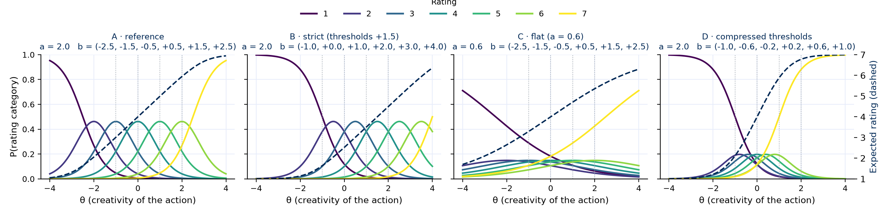{.nostretch width="100%"}

::::: columns
::: {.column width="52%"}
**Expected rating of an action with creativity θ**

| Rater | θ = −1 | θ = 0 | θ = +1 | θ = +2 |
|---|---:|---:|---:|---:|
| A · reference | 3.01 | 4.00 | 4.99 | 5.94 |
| B · strict (thresholds +1.5) | 1.64 | 2.52 | 3.50 | 4.50 |
| C · flat (a = 0.6) | 3.29 | 4.00 | 4.71 | 5.36 |
| D · compressed thresholds | 2.12 | 4.00 | 5.88 | 6.78 |
:::

::: {.column width="48%"}
- **Shift the thresholds** (B): every action gets about 1.5 points less. *Severity.*
- **Lower a** (C): the actions at θ = −1 and +2 are 2.9 points apart for A, 2.1 for C. *Discrimination.*
- **Compress the thresholds** (D): the whole scale is used over a narrow θ range; beyond it the rating saturates at 1 or 7. *Category use.*
:::
:::::

## Backlog · RQ2 · Where the information comes from {.smaller visibility="uncounted"}

::::: columns
::: {.column width="46%"}
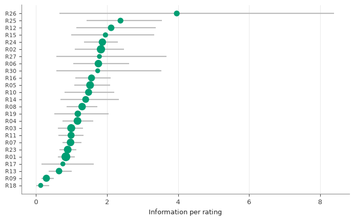{height="320"}

::: {.citation}
Average information per rating (integrated over θ ~ N(0, 1)) for each rater, 95% intervals from 200 parameter draws; point size ∝ √(number of ratings).
:::
:::

::: {.column width="54%"}
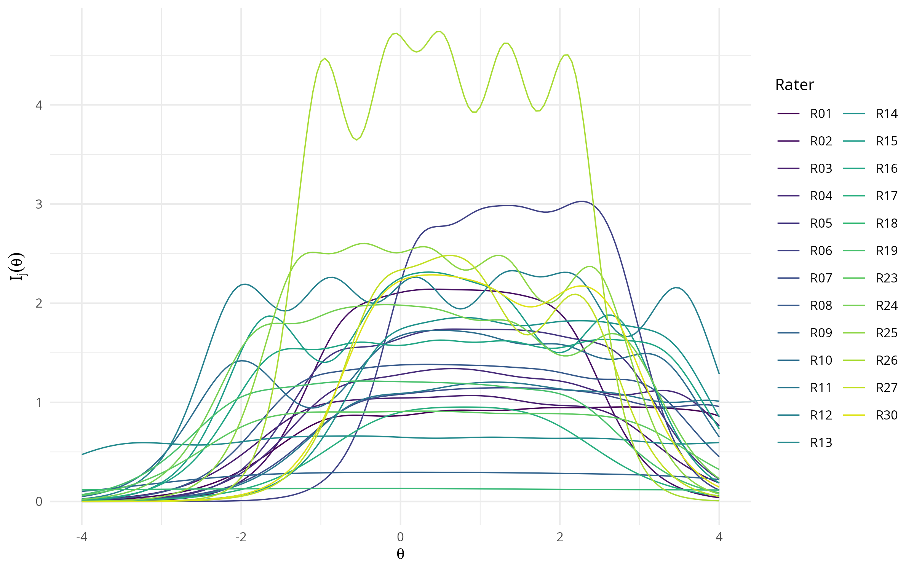{height="320"}

::: {.citation}
Rater information functions $I_j(\theta)$ of the graded response model.
:::
:::
:::::

::: {style="margin-top:0.7em"}
- Information per rating ranges from **0.13 (R18) to 3.96 (R26)**: one rating from a sharp rater is worth many from a flat one.
- Sharp raters inform mostly where their thresholds sit, in the middle of the θ range; flat raters inform almost nowhere.
:::

## Backlog · What follows for rating studies of actions in sport {.spread visibility="uncounted"}

1. **Report the reliability of the scores actually used**, and the agreement of single ratings, not only alpha or full-panel values (.69 vs .96 and .97 here).
2. **Plan several ratings per action.** One or two gave .53 and .70; four reached .80 in this pool.
3. **Let all raters rate a common calibration set**, so that raters are linked and the parameters of raters with few ratings become estimable. (Not the same as training, which conflicts with the CAT's "no criteria" rule.)
4. **Give each rater enough ratings.** About 50 still left the parameters imprecise.
5. **Consider rater-adjusted scoring** and report how far it departs from raw means. The data do not show that model scores are more *valid*, only that raw means carry rater effects.
6. **Treat these figures as specific** to this product class, rater pool and scale.

::: notes
Design recommendations from the Discussion box of the manuscript; kept as a backlog slide for the discussion.
:::
